# 工业大数据课堂实验

>数据集来源：课堂项目实践_数据.zip
>
>指导：第01单元 课堂项目实践.pptx
>
>路径中：.\表示当前文件夹，例如：.\1_1_Dataset\ffmpeg，表示当前文件夹下的 1_1_Dataset 文件夹 中的 ffmpeg 文件夹
>
>实验环境：配置一个conda 环境，例如：IndustrialBigData，python版本是3.12，下载对应版本的cuda并安装pytorch
>
>* 测试代码：
>
>  ```python
>  import torch
>  print(torch.__version__)
>  print(torch.cuda.is_available())
>      
>  输出：
>  (base) PS F:\工业大数据实验> conda activate IndustrialBigData
>  (IndustrialBigData) PS F:\工业大数据实验> python test.py
>  2.14.1+cu126
>  True
>  ```
>
>

## 1、准备 FFmpeg

这步是利用代码：[audit_dataset.py](".\1_2_Data processing\audit_dataset.py)

1. 从 https://www.gyan.dev/ffmpeg/builds/#release-builds 下载：[ffmpeg-release-essentials.zip ](https://www.gyan.dev/ffmpeg/builds/ffmpeg-release-essentials.zip)109 MB

   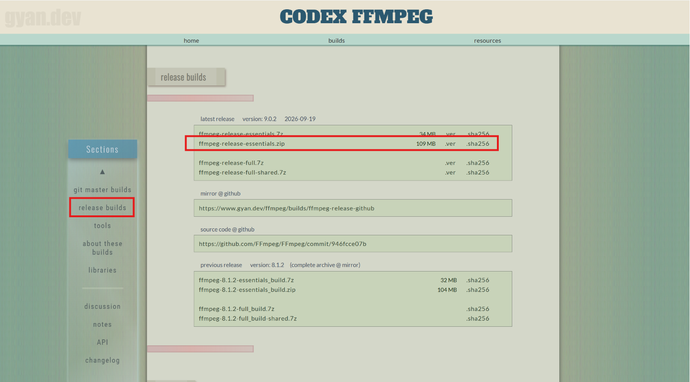

2. 压缩包解压到：`.\1_1_Dataset\ffmpeg`。

   >**FFmpeg 是处理视频和音频的工具。** 在你的实验中，它主要负责准备媒体数据，供后续特征提取使用。
   >
   >程序包中通常包含两个主要工具：
   >
   >| 工具          | 作用                                 | 在你实验中的用途                                             |
   >| ------------- | ------------------------------------ | ------------------------------------------------------------ |
   >| `ffmpeg.exe`  | 提取音轨、转换格式、调整采样率和声道 | 从 MP4 视频生成 WAV 音频，交给 openSMILE 或文本时间对齐工具  |
   >| `ffprobe.exe` | 查看媒体参数                         | 检查时长、帧率、音频采样率及音视频起始时间，为时序对齐提供依据 |
   >
   >这些功能分别见 [FFmpeg 文档](https://ffmpeg.org/ffmpeg.html) 和 [FFprobe 文档](https://ffmpeg.org/ffprobe.html)。
   >
   >**“Windows 64 位构建”就是已经编译好的、适用于 64 位 Windows 的程序包。** 下载并解压后就能使用其中的 `.exe`，不需要自己编译。FFmpeg 官方下载页链接了 gyan.dev 和 BtbN 提供的 Windows 程序包。[官方下载入口](https://ffmpeg.org/download.html)
   >
   >它是独立程序，**不需要新建 Python 环境**；后续 Python 脚本可以直接调用它。你的处理链可以理解为：
   >
   >**MP4 视频 → FFmpeg 提取音频 → openSMILE 提取语音特征**
   >
   >BERT 负责文本语义特征，OpenFace 负责面部特征；FFmpeg 负责前面的媒体准备工作。

3. 在 PowerShell 中执行：

```
conda activate IndustrialBigData


python -m pip install openpyxl


python ".\1_2_Data processing\audit_dataset.py" --ffprobe ".\1_1_Dataset\ffmpeg\bin\ffprobe.exe"
```

运行后会生成 `dataset_manifest.csv` 和 `dataset_audit.json`。


## 2、匹配官方词级时间戳

这步利用[prepare_word_timestamps.py](".\1_2_Data processing\prepare_word_timestamps.py")，生成：word_timestamp_audit.json

先自行创建目录 `.\1_1_Dataset\MOSEI官方时间标注`

1. 下载以下两个文件，保留文件名，放入该目录`.\1_1_Dataset\MOSEI官方时间标注`：

   | 文件                             | 大小    | 入口                                                         |
   | -------------------------------- | ------- | ------------------------------------------------------------ |
   | `CMU_MOSEI_TimestampedWords.csd` | 37.9 MB | [打开文件页面](https://huggingface.co/datasets/reeha-parkar/cmu-mosei-comp-seq/blob/main/data/CMU_MOSEI_TimestampedWords.csd) |
   | `CMU_MOSEI_Labels.csd`           | 23.3 MB | [打开文件页面](https://huggingface.co/datasets/reeha-parkar/cmu-mosei-comp-seq/blob/main/data/CMU_MOSEI_Labels.csd) |

   打开页面后点击 **Download**

   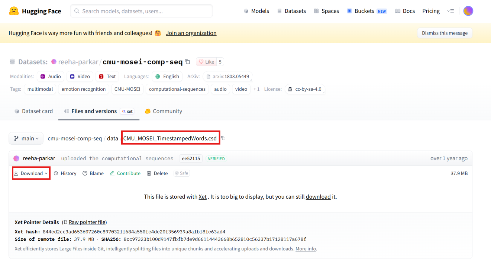

2. 在项目根目录运行：

```powershell
conda activate IndustrialBigData

python -m pip install h5py

python ".\1_2_Data processing\prepare_word_timestamps.py"
输出结果：
....
已核对 80/100 个片段
已核对 90/100 个片段
已核对 100/100 个片段
完成：{'candidate': 16, 'needs_alignment': 84, 'error': 0}；候选词 296 个；播放复核待完成 16 个片段。
报告位于 .\1_2_Data processing
```


## 3、补齐 84 个未匹配片段的词时间戳

利用[force_align_words.py](F:/工业大数据实验/1_2_Data processing/force_align_words.py)，实现采用其[词时间对齐接口](https://github.com/openai/whisper/blob/v20250625/whisper/timing.py)。

1. 手动下载官方 [small.en.pt](https://openaipublic.azureedge.net/main/whisper/models/f953ad0fd29cacd07d5a9eda5624af0f6bcf2258be67c92b79389873d91e0872/small.en.pt)，保存到 `.\1_1_Dataset\small.en.pt`。
2. 在 PowerShell 中安装依赖，再处理 **1 个片段**：

```powershell
conda activate IndustrialBigData
python -m pip install "openai-whisper==20250625"

python ".\1_2_Data processing\force_align_words.py" --model-file ".\1_1_Dataset\small.en.pt"
输出结果：
加载本地 small.en；模型设备 cuda，时间对齐算子 CPU；待处理 1 个片段。
[1/1] -3g5yACwYnA/13：forced_candidate；词 15 个
完成：{'forced_candidate': 1, 'needs_alignment': 83, 'candidate': 16}；本次对齐异常 0 个；报告位于 .\1_2_Data processing
```

3. 查看生成的 [词时间戳 CSV](F:/工业大数据实验/1_2_Data processing/word_timestamps_aligned.csv) 和 [对齐报告](F:/工业大数据实验/1_2_Data processing/forced_alignment_audit.json)，试听核对开头、中间、结尾的词。验收重点是词序完整、时间正常、没有零时长或越界词；出现 `forced_review` 时先检查具体标记。

单片段验收通过后，处理全部待对齐片段：

```powershell
python ".\1_2_Data processing\force_align_words.py" --model-file ".\1_1_Dataset\small.en.pt" --limit 0 --overwrite
```

运行结果：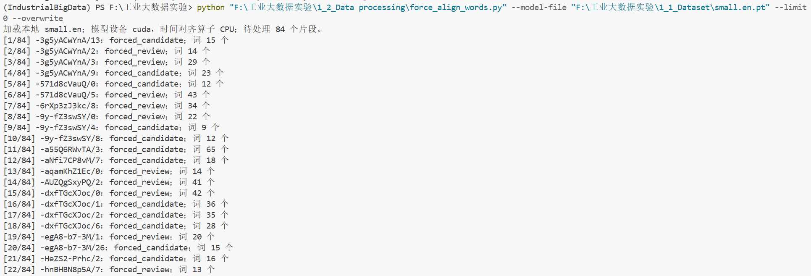

`--overwrite` 会更新本步骤的试跑结果。

> ==主意：==**1 个未对齐片段：原视频音轨全静音。** 文件是 `.\1_1_Dataset\MOSEI数据集部分原始视频-100条\-mJ2ud6oKI8\2.mp4`。我用 FFmpeg 独立检查，两个声道的采样值均为 0，因此无法从音轨定位文本中的发音时间。
>
> **99 个无效词区间：模型返回了零时长。** 它们分布在 **25 个片段**中。例如 `and` 的开始和结束时间都是 `6.78 秒`。当前 Whisper 对齐算法可能把词的两个边界定位到同一时间点；脚本将这些结果明确标记为无效。


## 4、BERT 提取 text_features

本步骤利用的是：[extract_bert_features.py](F:/工业大数据实验/1_2_Data processing/extract_bert_features.py)

1. 请自行创建两个目录：

```powershell
.\1_1_Dataset\bert-base-uncased
.\1_2_Data processing\text_features
```

1. 从[官方模型文件页](https://huggingface.co/google-bert/bert-base-uncased/tree/main)下载以下文件，放入第一个目录：

   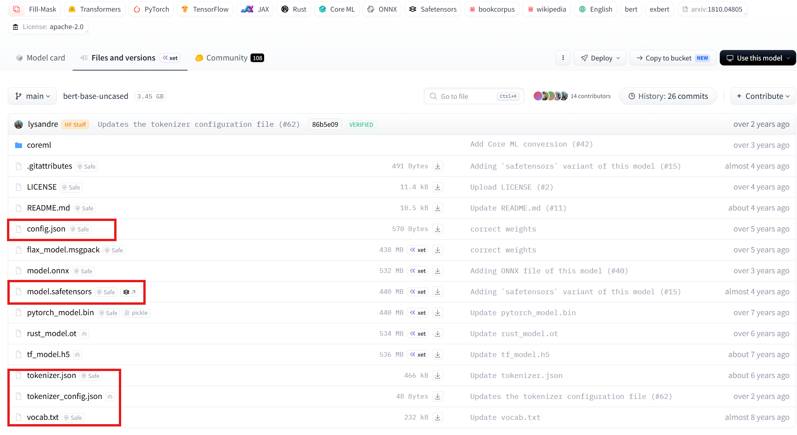

```powershell
config.json
model.safetensors
tokenizer.json
tokenizer_config.json
vocab.txt
```

1. 在全局环境安装依赖，先提取 **1 个片段**：

```powershell
conda activate IndustrialBigData

python -m pip install "transformers==4.57.6"
输出结果：
Installing collected packages: safetensors, pyyaml, huggingface-hub, tokenizers, transformers
Successfully installed huggingface-hub-0.36.2 pyyaml-6.0.3 safetensors-0.8.0 tokenizers-0.22.2 transformers-4.57.6


python ".\1_2_Data processing\extract_bert_features.py"
输出结果：
本地 BERT-base，设备 cuda；提取 1 个片段。
[1/1] -3g5yACwYnA/13：ok；token 18
完成：{'ok': 1}；特征 18 个 token × 768 维；报告位于 .\1_2_Data processing\text_features
```

结果位于 `text_features`：每个片段一个 `.npz`，另有 `bert_feature_summary.csv` 和 `bert_feature_audit.json`。

```json
"video_id": "-3g5yACwYnA",
      "clip_id": "13",
      "status": "ok",
      "feature_file": "F:\\工业大数据实验\\1_2_Data processing\\text_features\\-3g5yACwYnA__13.npz",
      "error": "",
      "token_count": 18,
      "feature_dimension": 768,
```

验收重点：`error=0`、特征维度为 768、均值和方差为有限数值；时间缺失按你的选择保留为 `NaN + mask`，并标记 `review`。

单片段验收通过后，运行全部 100 个：

```powershell
python ".\1_2_Data processing\extract_bert_features.py" --limit 0 --overwrite
输出结果：
...
[99/100] -yRb-Jum7EQ/5：review；token 31
[100/100] -yRb-Jum7EQ/6：review；token 24
完成：{'ok': 46, 'review': 54}；特征 2317 个 token × 768 维；报告位于 .\1_2_Data processing\text_features
```

运行结果：

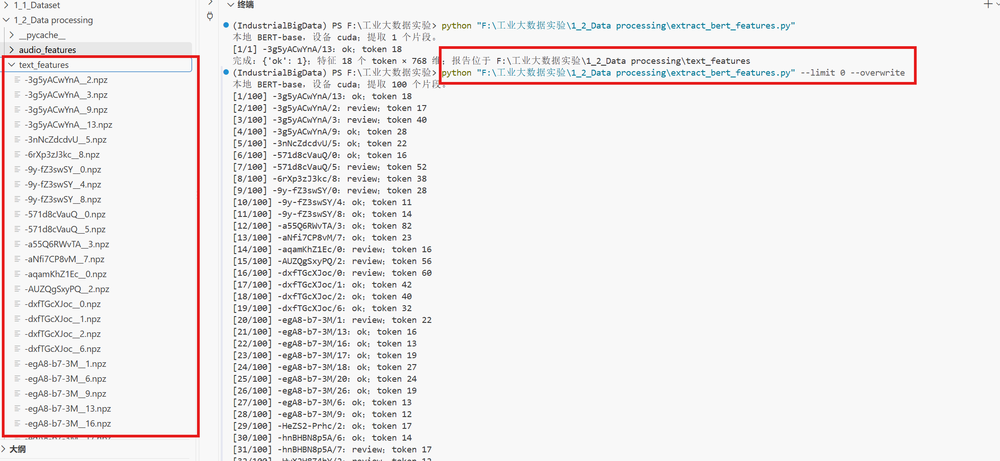

## 5、Opensmile 提取 audio_features

本步骤利用的是：已写好 [extract_audio_features.py](F:/工业大数据实验/1_2_Data processing/extract_audio_features.py)文件

1. 请自行创建输出目录：.\1_2_Data processing\audio_features

2. 安装依赖，先处理 **1 个片段**：

```powershell
conda activate IndustrialBigData
python -m pip install "opensmile==2.6.0"
输出结果：
Successfully installed asttokens-3.0.2 audeer-2.6.0 audformat-1.4.3 audinterface-1.4.0 audiofile-1.6.1 audmath-1.4.4 audobject-0.7.13 audresample-1.3.6 cffi-2.1.1 iso3166-3.0.0 iso639-lang-2.6.3 opensmile-2.6.0 oyaml-1.0 pandas-3.0.6 pyarrow-26.0.0 pycparser-3.11 python-dateutil-2.9.0.post0 six-1.17.0 soundfile-0.14.0 tzdata-2026.5

python ".\1_2_Data processing\extract_audio_features.py"
输出结果：
openSMILE eGeMAPSv02 LLD，CPU，16kHz 单声道；提取 1 个片段。
[1/1] -3g5yACwYnA/13：ok；帧 535
完成：{'ok': 1}；535 帧 × 25 维；报告位于 .\1_2_Data processing\audio_features
```

结果包括每片段一个 `.npz`，以及 `audio_feature_summary.csv`、`audio_feature_audit.json`。

验收重点：`error=0`、维度为 25、`frame_hop_s=0.01`；有有效观测的维度，其均值和方差应为有限值。全静音片段保留 `review` 和缺失掩码。

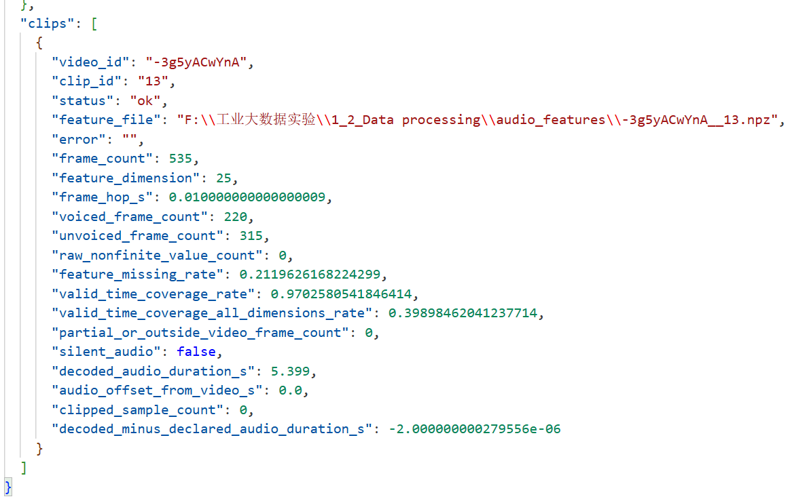

3. 单片段验收通过后，处理全部 100 个：

```powershell
python ".\1_2_Data processing\extract_audio_features.py" --limit 0 --overwrite
输出结果：
....
[99/100] -yRb-Jum7EQ/5：ok；帧 1300
[100/100] -yRb-Jum7EQ/6：ok；帧 1120
完成：{'ok': 76, 'review': 24}；77261 帧 × 25 维；报告位于 .\1_2_Data processing\audio_features
```

运行结果：

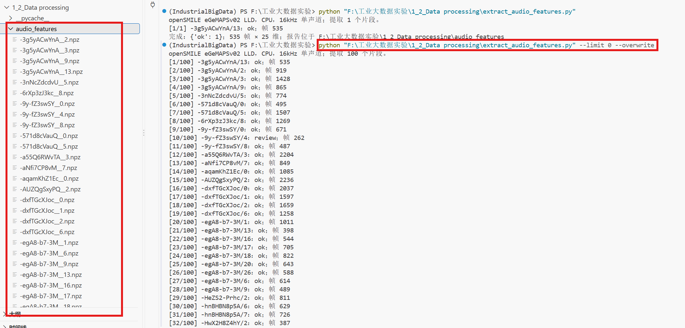

## 6、OpenFace 提取 visual_features 。

[extract_visual_features.py](F:/工业大数据实验/1_2_Data processing/extract_visual_features.py)

1. 手动下载 [OpenFace 2.2.0 Windows 64 位程序](https://github.com/TadasBaltrusaitis/OpenFace/releases)，完整解压，使程序位于：.\1_1_Dataset\OpenFace\FeatureExtraction.exe。
   保留附带的 DLL、`model` 和 `AU_predictors` 文件夹。

   2. 按[官方模型下载页](https://github.com/TadasBaltrusaitis/OpenFace/wiki/Model-download)补齐以下文件，放入 `.\1_1_Dataset\OpenFace\model\patch_experts`：

      ```txt
      cen_patches_0.25_of.dat
      cen_patches_0.35_of.dat
      cen_patches_0.50_of.dat
      cen_patches_1.00_of.dat
      ```

      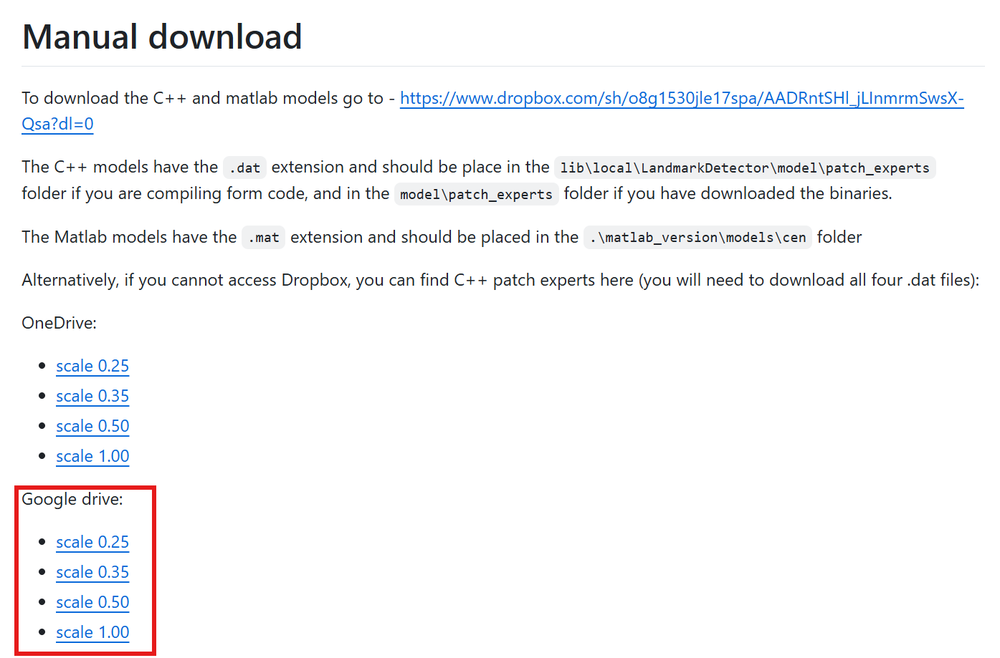

   3. 自行创建 `.\1_2_Data processing\visual_features`，先处理 **1 个片段并保存追踪预览**：

      ```powershell
      conda activate IndustrialBigData
      python ".\1_2_Data processing\extract_visual_features.py" --save-tracked
      
      输出结果：
      OpenFace 单人视频追踪，159 维，confidence≥0.8；处理 1 个片段。
      [1/1] 开始 -3g5yACwYnA/13
      [1/1] ok；帧 163
      完成：{'ok': 1}；163 帧 × 159 维；报告位于 .\1_2_Data processing\visual_features
      ```
   
      验收时确认预览追踪的是主讲者，报告中 `error=0`、维度为 159，并检查人脸检测成功率、缺失率和有效时间覆盖率。默认置信度阈值为 `0.8`；视觉时间采用实际帧 PTS。
   
   4. 通过后处理全部 100 个：
   
      ```powershell
      python ".\1_2_Data processing\extract_visual_features.py" --limit 0 --overwrite
      
      输出结果：
      [100/100] 开始 -yRb-Jum7EQ/6
      [100/100] ok；帧 336
      完成：{'ok': 71, 'review': 29}；23241 帧 × 159 维；报告位于 .\1_2_Data processing\visual_features
      ```
      
      运行结果：
      
      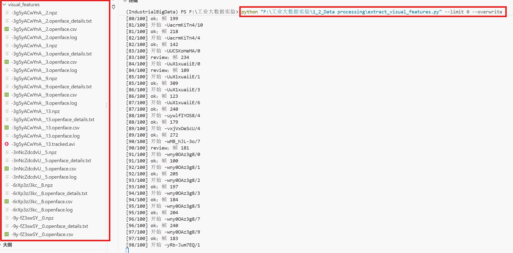

# 至此，文本、音频、视频特征已经全部提取。要求与PPT一致。

| 特征种类 | 采用模型          | 存放位置                                                |
| -------- | ----------------- | ------------------------------------------------------- |
| 文本     | bert-base-uncased | ".\1_2_Data processing\text_features"   |
| 视频     | opensmile==2.6.0  | ".\1_2_Data processing\audio_features"  |
| 音频     | OpenFace          | ".\1_2_Data processing\visual_features" |


## 7、按词区间完成三模态对齐 aligned_featuress

利用 [align_multimodal_features.py](F:/工业大数据实验/1_2_Data processing/align_multimodal_features.py)

保存 768、25、159 维词级特征，以及拼接后的 952 维矩阵；原始 BERT token 嵌入继续保留。

1. 自行创建输出目录：`.\1_2_Data processing\aligned_features`

2. 补齐片段

   ```powershell
   conda activate IndustrialBigData
   python ".\1_2_Data processing\align_multimodal_features.py"
   输出结果：
   [1/1] -3g5yACwYnA/13：review；词 15；三模态共同有效 15
   完成：{'review': 1}；词 15 个；三模态共同有效 15 个；无词区间片段 0 个。
   报告位于 .\1_2_Data processing\aligned_features
   ```

3. 对齐100个

   ```powershell
   python ".\1_2_Data processing\align_multimodal_features.py" --limit 0 --overwrite
   ```

   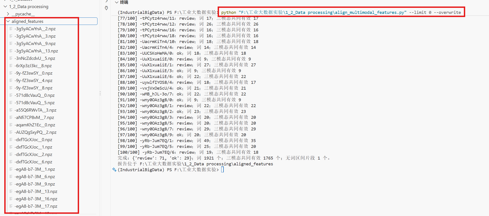


## 8、对齐后的质量评价与诊断绘图

利用： [评价脚本](F:/工业大数据实验/1_2_Data processing/evaluate_multimodal_features.py)

依次运行：

```powershell
conda activate IndustrialBigData

python -m pip install matplotlib

New-Item -ItemType Directory -Force -Path ".\5_Analyzing Experiments\multimodal_quality"

python ".\1_2_Data processing\evaluate_multimodal_features.py" --self-test
输出：Self-test passed（合成统计与 NPZ 检查通过；未评价实际数据、未出图）

python ".\1_2_Data processing\evaluate_multimodal_features.py"
```

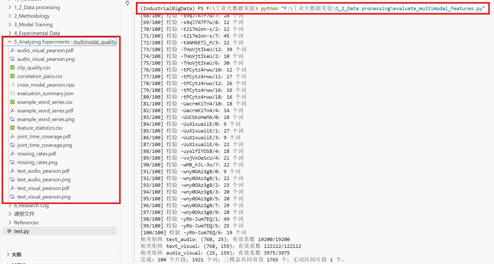


## 9、结论分析

### 一、实验总体结论

由：`.\5_Analyzing Experiments\multimodal_quality\evaluation_summary.json` 记录数据中：

| 我之前给出的指标            | 原始文件                  | 字段或计算方法                       |
| --------------------------- | ------------------------- | ------------------------------------ |
| 三模态共同有效词比例 91.88% | `evaluation_summary.json` | `joint_word_rate`                    |
| 共同有效时间覆盖率 77.36%   | `evaluation_summary.json` | `joint_valid_time_coverage_rate`     |
| 原始人脸检测成功率 94.50%   | `evaluation_summary.json` | `source_face_detection_success_rate` |
| 需要复核的片段 71/100       | `clip_quality.csv`        | 统计 `status == "review"` 的行数     |

目前最重要的发现有三个：

1. 特征提取成功，三模态已经形成统一的词级特征矩阵。 数据维度正确，绝大多数词能够找到对应的文本、语音、视觉特征。
2. 视觉模态是有效覆盖率的主要限制因素。 词级时间戳缺失和少数人脸检测失败的片段也值得重点处理。
3. 跨模态 Pearson 相关性总体较弱，但不代表对齐失败。 相关系数反映特征变化之间的线性关系，而不是时间边界正确与否。尤其是 BERT 的单个维度，本身就不对应明确的语义概念。

### 二、实验结果表格分析

#### 1. 数据规模与特征维度

| 项目                      | 实验结果 | 分析                   |
| ------------------------- | -------- | ---------------------- |
| 视频片段                  | 100      | 完成全部目标片段       |
| 来源视频                  | 37       | 多个片段来自相同原视频 |
| 词级观测                  | 1,921    | 统一时间序列的基础     |
| 有效时间戳词              | 1,822    | 99 个词缺失有效词区间  |
| 三模态共同有效词          | 1,765    | 占所有词的 91.88%      |
| 所有 952 个特征均有效的词 | 1,714    | 占所有词的 89.22%      |
| 无有效词区间的片段        | 1        | 无法正常执行词级对齐   |
| 被标记质量问题的词        | 255      | 需要检查具体标记原因   |

注意：

- `joint_word_count = 1765` 表示一个词在三个模态中都至少有可用特征。
- `all_features_word_count = 1714` 表示对应词的 952 个特征全部有效。

所以，三模态可用不等于每一维数据都完整。例如，一个词可能存在语音响度特征，但基频 F0 特征缺失。这也是后续模型训练必须使用 `mask` 的原因。

#### 2. 缺失率表格：

`feature_statistics.csv`：".\5_Analyzing Experiments\multimodal_quality\feature_statistics.csv"

| 模态           | 特征维度 | 缺失率 | 评价                               |
| -------------- | -------- | ------ | ---------------------------------- |
| 文本 BERT      | 768      | 5.15%  | 缺失来自无有效词时间区间           |
| 语音 openSMILE | 25       | 6.90%  | 总体较低，部分发声相关维度缺失较多 |
| 视觉 OpenFace  | 159      | 8.12%  | 三模态中最高，值得重点优化         |

> 这组数据说明：
>
> 文本模态最完整。 768 个 BERT 维度各有 1,822 个有效词，表明对齐后的文本缺失主要与词时间戳有关，而不是特定 BERT 维度提取失败。
>
> 语音模态存在有规律的缺失。 F0、jitter、shimmer 等特征的缺失率约为 8.80%，而一些频谱、响度等特征约为 5.83%。
> 这是可以理解的：清辅音、静音或无声段可能无法定义稳定的基频和声质指标。
>
> 视觉模态受人脸追踪限制。 所有 159 个视觉维度表现出相同的词级缺失率，符合当前将人脸追踪失败的词区间整体设为缺失的处理方式。
>
> 缺失率低，只能说明数据比较完整，但不等于数据一定准确。

#### 3. 平均值与方差：

`feature_statistics.csv` 一些有代表性的结果：

| 特征                 | 均值    | 方差        |
| -------------------- | ------- | ----------- |
| BERT 第 0 维         | 0.055   | 0.280       |
| BERT 第 308 维       | -4.208  | 1.064       |
| Loudness（响度）     | 0.686   | 0.128       |
| F0（半音标度）       | 29.196  | 36.364      |
| Jitter               | 0.0176  | 0.000251    |
| AU12（笑肌相关动作） | 0.297   | 0.203       |
| AU25（嘴唇分开）     | 0.528   | 0.195       |
| 面部关键点 x_15      | 499.384 | 64,065.589  |
| 头部平移 pose_Tz     | 761.211 | 110,814.183 |

> 这些数值没有直接的好坏标准，原因是各个维度的物理意义和量纲不同。
>
> 例如，`pose_Tz` 的方差很大，不一定说明数据异常，它可能包含拍摄距离的变化；面部关键点像素坐标的方差也可能受到视频分辨率、人物位置和镜头裁剪的影响。
>
> 相反，Jitter 的方差很小，也不代表它没有信息，因为其数值尺度本来就小。

### 三、逐张分析 6 张实验结果图

#### 图 1：三模态缺失率

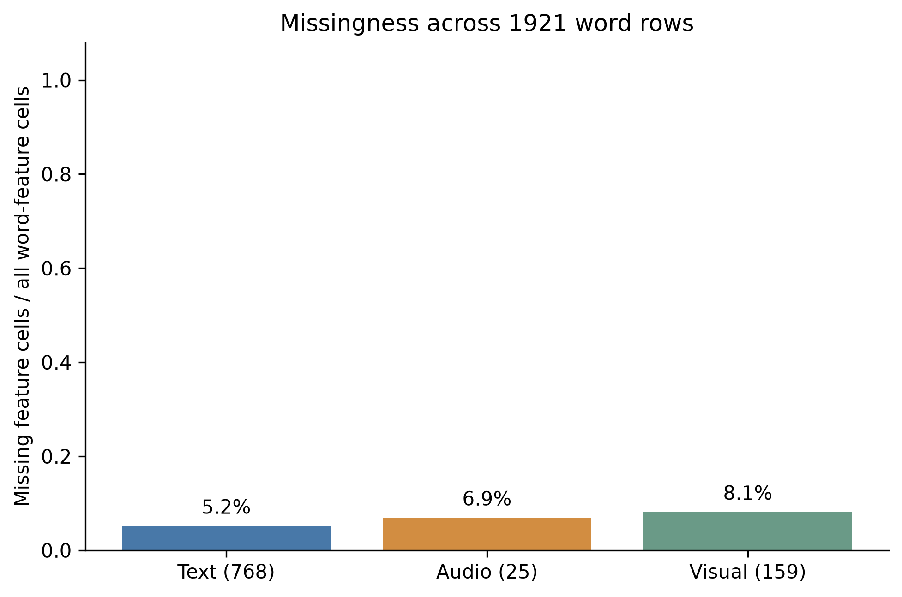

>结论： 缺失主要集中在时间戳、无声发声相关特征和人脸追踪失败，而非大规模征提取中断。

#### 图 2：共同有效时间覆盖率

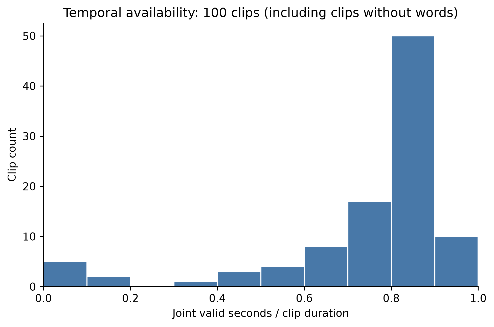

这张图比缺失率图更值得关注。

绝大多数片段集中在较高覆盖率区间，但存在少数明显异常的片段。这些异常可以单独复核，而不是仅查看全局均值。

这里还可以做一个更有价值的指标分解：

| 时间覆盖指标                                                 | 覆盖率 |
| ------------------------------------------------------------ | ------ |
| 有效词时间区间占视频总时长                                   | 82.51% |
| 三模态共同有效时间占视频总时长                               | 77.36% |
| 已有词区间时长中三模态共同有效的比例，根据 `clip_quality.csv` 计算而来 | 93.76% |

77.36% 并不意味着有 22.64% 的对齐内容失败。视频中可能包含没有词标注的停顿、静音或其他非语音部分。

对==按词组织==的多模态实验而言，93.76% 是更有针对性的覆盖诊断指标。

#### 图 3：文本—语音 Pearson 相关性

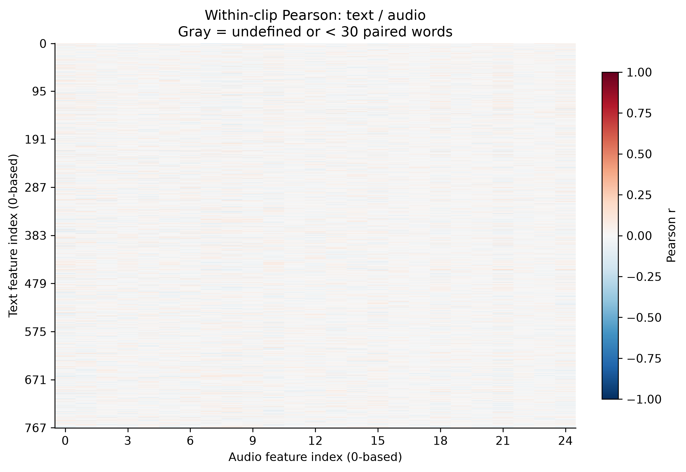

共：768 × 25 = 19,200 组特征对，对 NPZ 中全部相关系数计算后得到：

```python
import numpy as np

# 读取相关系数矩阵
data = np.load(
    "multimodal_quality/cross_modal_pearson.npz"
)

# 提取文本-语音相关系数
r = data["text_audio_r"]

# 1. 平均绝对相关系数
mean_abs_r = np.nanmean(np.abs(r))

# 2. 最大正相关
max_r = np.nanmax(r)

# 3. 最大负相关
min_r = np.nanmin(r)

# 4. |r| >= 0.1 的比例
valid = r[np.isfinite(r)]
ratio = np.mean(np.abs(valid) >= 0.1) * 100

print("相关系数矩阵形状:", r.shape)
print("平均绝对相关系数:", mean_abs_r)
print("最大正相关:", max_r)
print("最大负相关:", min_r)
print("|r| >= 0.1 的比例:", ratio, "%")
```

- 平均绝对相关系数：0.0315
- 最大正相关：+0.1707
- 最大负相关：-0.1536
- 绝对相关系数达到 0.1 的比例：1.40%

其中最强的正相关特征对为 `BERT_388` 与 `Loudness_sma3`，相关系数约为 +0.171。

> 解读： 单独的 BERT 隐层维度与声学 LLD 维度之间，通常不存在明显的线性相关关系。
>
> 这是合理的。BERT 特征主要编码上下文语义信息，而 openSMILE 特征更多反映发音、语调、响度和声道特性。
>
> 例如，说出相同的单词，可以使用完全不同的音量和语气；语义信息相近，并不必然产生相近的声学特征。

#### 图 4：文本—视觉 Pearson 相关性

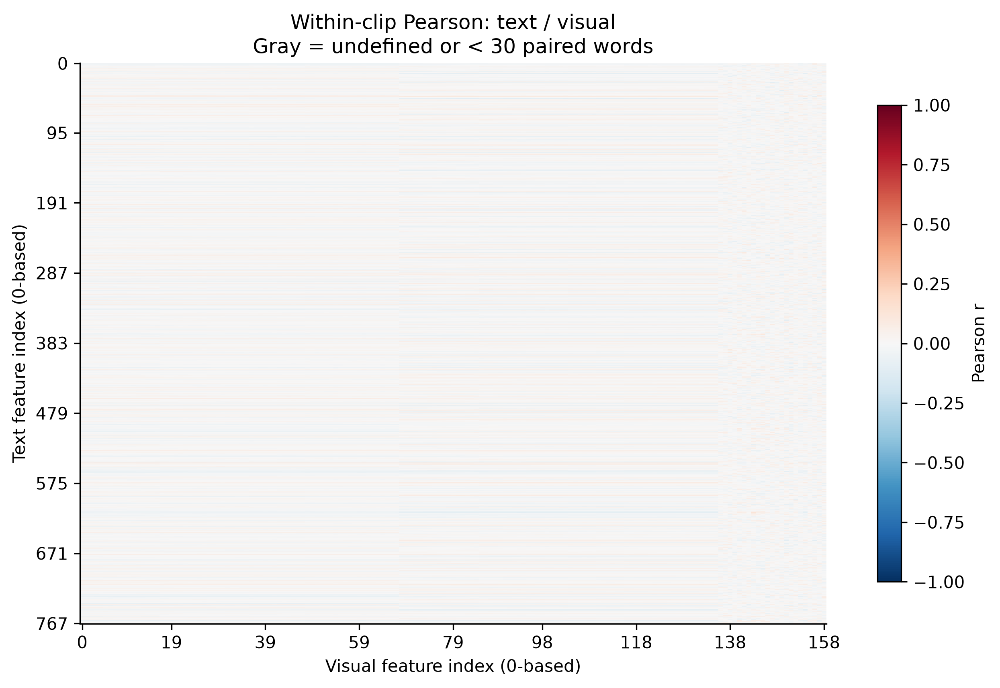

共：768 × 159 = 122,112 组特征对

分析结果：

- 平均绝对相关系数：0.0245
- 最大正相关：+0.1254
- 最大负相关：-0.1235
- 绝对相关系数达到 0.1 的比例：0.21%

其中 `BERT_615` 与 `AU10_r` 的相关系数约为 +0.125；`BERT_721` 与 `AU12_r` 约为 -0.124。

> 相比文本—语音，文本—视觉的原始维度线性相关性更弱。
>
> 可能原因包括：文本主要是语义表征，而视觉主要是几何和面部动作表征；并不是所有单词都与特定表情动作相对应。
>
> 但也不能排除表示方式的影响。例如，直接使用 68 个面部关键点的原始像素坐标，可能引入很多与词义无关的位置变化。
>
> 这里更适合先做特征层面的转换，如面部坐标归一化、提取嘴部张开程度和眉毛运动幅度，再研究与语言或情绪信息的关系。

#### 图 5：语音—视觉 Pearson 相关性

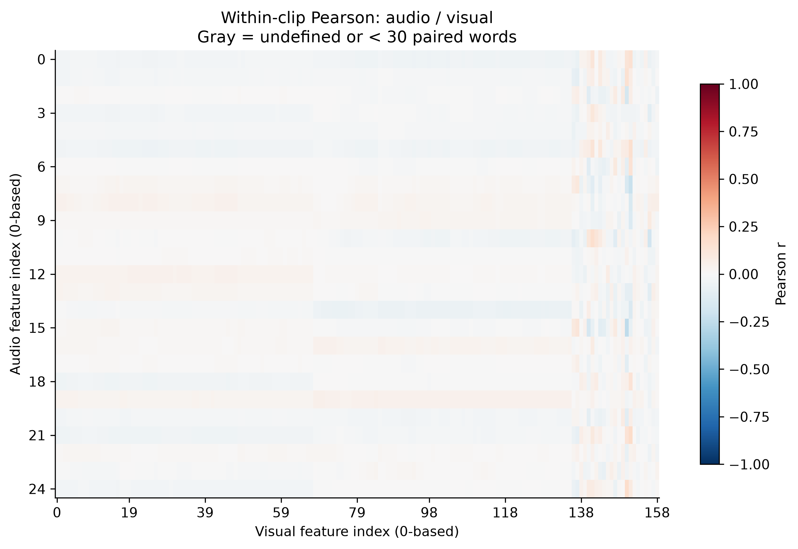

共：25 × 159 = 3,975 组特征对

虽然整体平均绝对相关系数只有 0.0213，但最强的特征对具有更明显的关联：

| 语音特征            | 视觉特征            | Pearson r |
| ------------------- | ------------------- | --------- |
| logRelF0-H1-A3      | AU25（嘴唇分开）    | -0.253    |
| MFCC2               | AU26（下颌下降）    | -0.222    |
| F0                  | pose_Rx（头部俯仰） | -0.189    |
| F2amplitudeLogRelF0 | AU26                | +0.184    |
| Loudness（响度）    | AU26                | +0.156    |

在原图中，右侧约第 136–158 列能够观察到更明显的颜色变化，主要对应 AU 和头部姿态特征。这可能反映了真实的音视频关系。例如，当人张开嘴巴、下颌运动时，发音和声学特征也会变化。

#### 三张相关性热力图的总体比较

| 模态组合  | 平均 \|r\| | 最大 \|r\| | 总体情况                     |
| --------- | ---------- | ---------- | ---------------------------- |
| 文本—语音 | 0.0315     | 0.1707     | 弱线性相关                   |
| 文本—视觉 | 0.0245     | 0.1254     | 弱线性相关                   |
| 语音—视觉 | 0.0213     | 0.2526     | 总体较弱，但局部有更明显关联 |

注意，这里的平均绝对相关系数仅用于描述分布，不是严格的跨模态对齐质量排名。

另外，三张热力图的色标均固定为 -1 到 +1，但实际绝大多数相关系数落在 -0.1 到 +0.1 之间。因此原图整体接近白色。

建议保留一版统一色标用于比较，再额外生成一版缩小到约 -0.3 到 +0.3 的细节热力图，以突出弱相关结构。

#### 图 6：词级时间序列示例

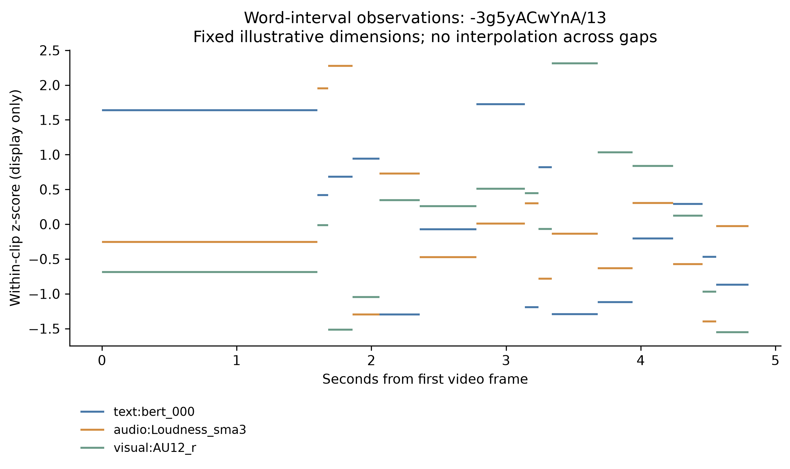

查看原始词级时间序列图

这张图选取了片段 `-3g5yACwYnA/13`，展示以下三个维度：

- 文本：`BERT_000`
- 语音：`Loudness_sma3`
- 视觉：`AU12_r`

> 它将每个词的特征值画在对应的词时间区间内，采用片段内 z-score，方便展示不同量纲的特征。
>
> 这张图最主要证明的是：三个模态的特征已经被映射到统一的词时间轴，可以按词索引直接比较。
>
> 示例图建议进一步标注每个词的文本、有效性掩码和异常区间，让它不仅展示特征，而且能辅助检查时间对齐。

### 四、发现的主要问题与异常片段

#### 1. 部分片段存在明显的覆盖失败

`.\5_Analyzing Experiments\multimodal_quality\clip_quality.csv` 中筛选的片段：

| 视频片段        | 共同有效时间覆盖率 | 人脸检测成功率 | 主要问题                       | 人工审核发现                           |
| --------------- | ------------------ | -------------- | ------------------------------ | -------------------------------------- |
| `-mJ2ud6oKI8/1` | 0%                 | 0%             | 语音、视觉均无有效词级特征     | 没有人脸和声音                         |
| `-mJ2ud6oKI8/2` | 0%                 | 63.16%         | 全静音、无词区间               | 有人脸，全程没有声音                   |
| `-NFrJFQijFE/1` | 0%                 | 0%             | 人脸检测失败，词特征也大量缺失 | 没有人脸，有背景音乐                   |
| `-NFrJFQijFE/2` | 0%                 | 0%             | 人脸检测失败                   | 有旁白，但是没有人脸                   |
| `-ri04Z7vwnc/0` | 0%                 | 0%             | 人脸检测失败                   | 没有人脸，有背景音乐                   |
| `-HwX2H8Z4hY/2` | 10.05%             | 29.41%         | 视觉覆盖严重不足               | 有人脸，但是处于背景板                 |
| `-HwX2H8Z4hY/5` | 14.62%             | 42.26%         | 人脸追踪不稳定                 | 后期画面中，人脸处于背景板，且没有字母 |

#### 2. Review 比例较高

从 `clip_quality.csv` 可知：

OK：29 个片段，Review：71 个片段。71 个 Review 不代表有 71 个完全不能使用的片段。但目前评价程序会保留这些词进行相关性分析。

`evaluation_summary.json` 显示相关性评价使用了最小覆盖阈值 0.5 和最小配对词数 30，但并未将全部 Review 词排除。

建议增加一组消融实验：分别使用全部数据、仅 OK 片段、排除质量标记词后的数据，重新计算相关系数矩阵。如果结果明显变化，说明原始相关性评价受数据质量影响较大。

#### 3. 尚未验证实际时间边界误差

当前缺少最关键的一组指标：预测时间戳与人工核实时间戳之间的误差。

建议随机抽取一定数量的词，人工标注起止时间，并计算：

\[ MAE_{\text{start}}=\frac{1}{N}\sum_{i=1}^{N}|\hat{s}_i-s_i| \]

结束时间采用同样的计算方式，还可以统计时间误差在 0.1 秒、0.2 秒以内的词所占比例。

此外，语音时间使用 FFmpeg 提取的音轨，而视觉使用实际帧 PTS，需要特别确认两者的视频起点、音频起点及任何时间偏移是否得到统一处理。

这部分验证完成后，才能真正评价时间对齐精度。

### 五、针对三个实验目标的改进建议

| 实验阶段          | 当前判断       | 最值得改进的地方                                            |
| ----------------- | -------------- | ----------------------------------------------------------- |
| 1. 时间序列组织   | 基本完成       | 保留原始时间、词时间、帧时间和对应 mask，并核对共同时间原点 |
| 2. 跨模态时序对齐 | 词级映射已完成 | 优先修正异常词时间戳、零覆盖片段和人脸追踪失败              |
| 3. 质量评价       | 已有描述性指标 | 增加人工时间边界误差、语音视觉时滞验证和统计稳健性检验      |

#### 推荐补充的工具

| 工具                           | 用途                             | 推荐理由                                       |
| ------------------------------ | -------------------------------- | ---------------------------------------------- |
| Montreal Forced Aligner（MFA） | 基于正确文本进行词和音素时间对齐 | 可作为 Whisper 对齐结果的独立对照              |
| Silero VAD                     | 语音活动检测                     | 区分没有语音的时段和真正的对齐缺失             |
| MediaPipe Face Landmarker      | 人脸关键点检测与追踪             | 可作为 OpenFace 检测失败时的备选方案           |
| CKA / 正则化 CCA               | 分析跨模态表示关系               | 比直接比较单个 BERT 维度更适合研究整体特征表示 |


